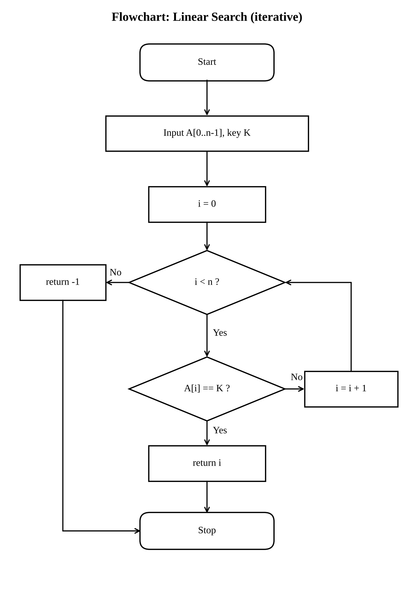
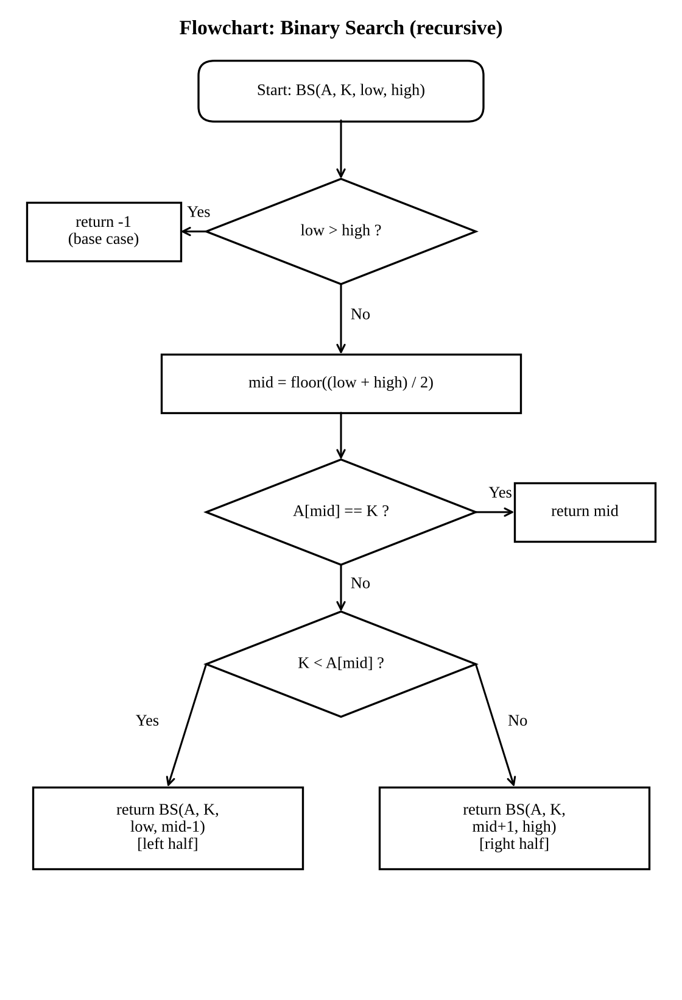
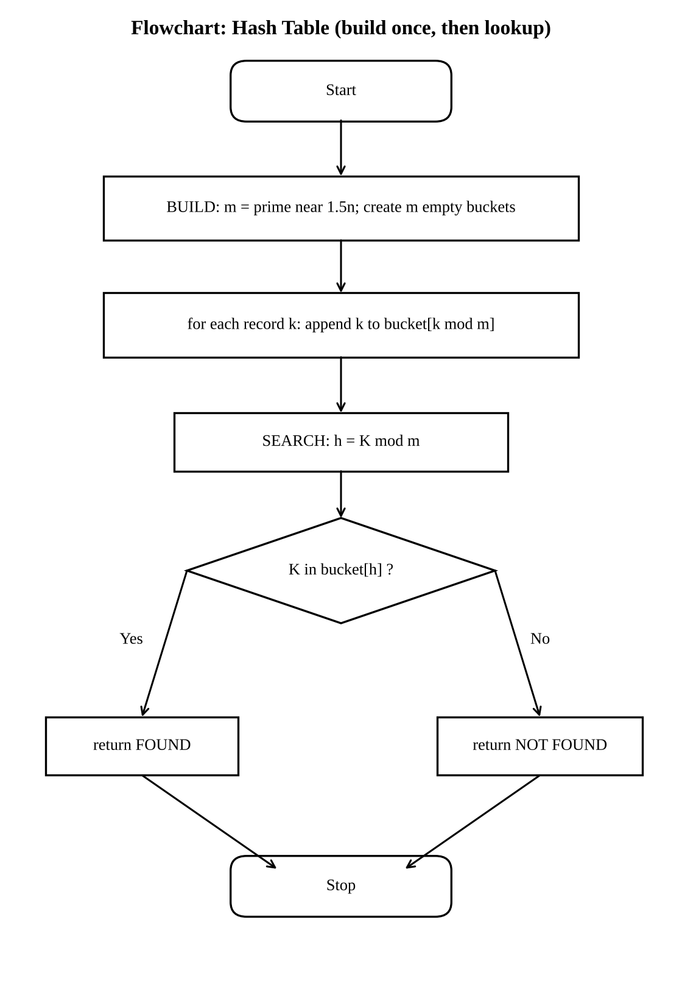
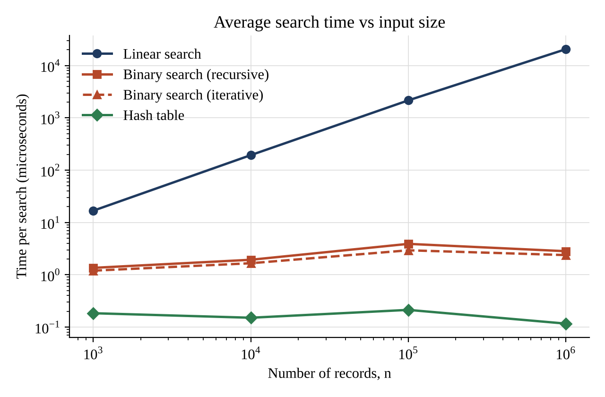
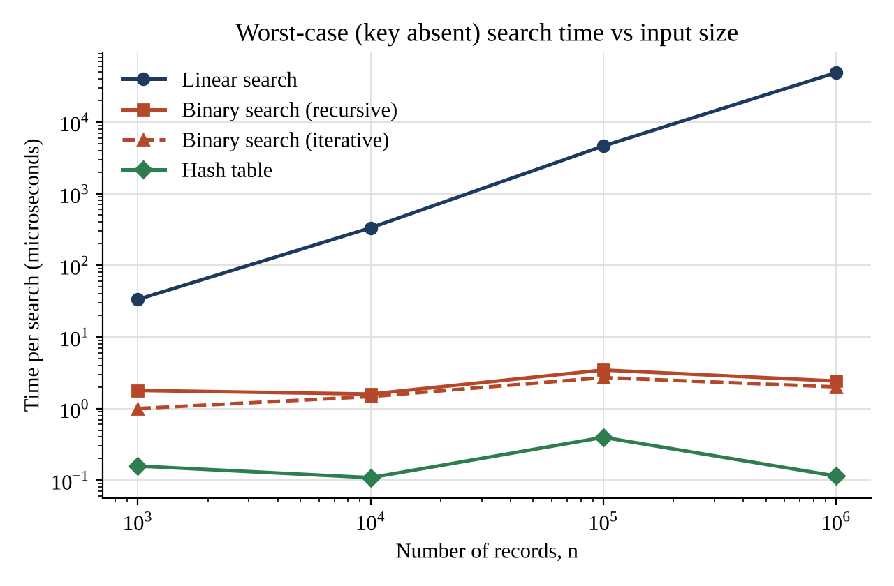
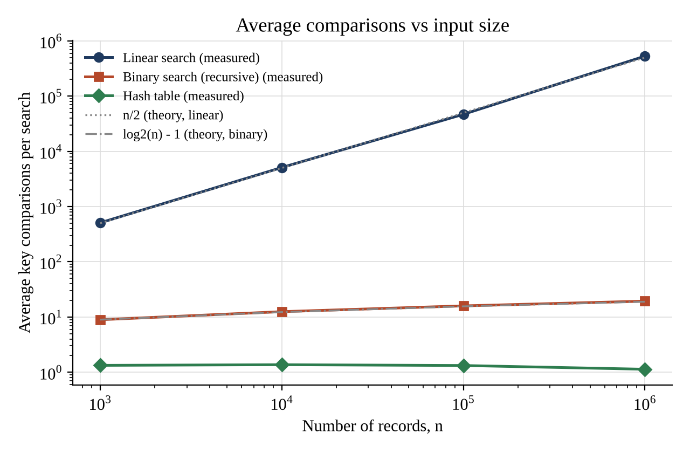
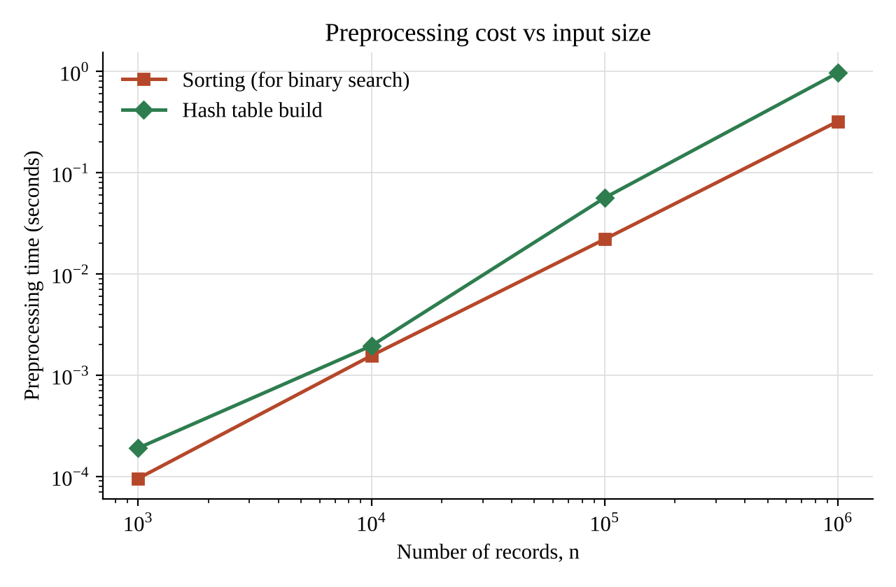
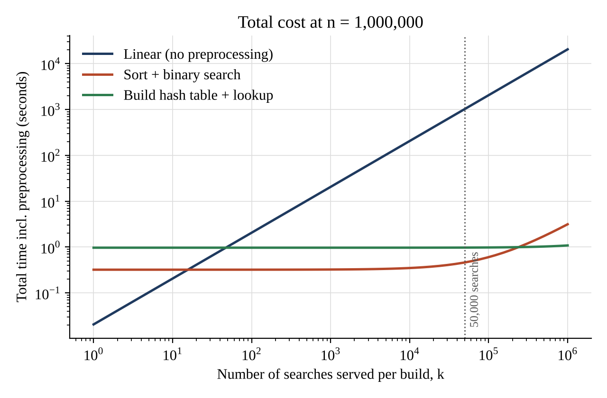

# Task 1 - Design the Algorithm (5 Marks)

Shaik Shahid | Reg. No. 192424311 | CSA0607 Design and Analysis of Algorithms

Problem. Given a collection of n student records, each identified by a unique 9-digit registration number (for example 192424311), decide whether a given registration number K exists and return the position of its record. The records are stored in memory as an array in the order in which they were created, so the array is not sorted. The database grows from 1,000 to 1,000,000+ records.

Three algorithmic strategies that are genuinely different in design technique, preprocessing and cost behaviour were selected.

**Table 1.1  Summary of the three selected approaches**

| Approach | Design strategy | Form | Preprocessing | Data structure |
|---|---|---|---|---|
| A. Linear search | Brute force | Iterative | None | Unsorted array |
| B. Binary search | Decrease and conquer (by half) | Recursive | Sort: Theta(n log n) | Sorted array |
| C. Hash table lookup | Transform and conquer (space-time trade-off) | Iterative | Build table: Theta(n) | Table of m buckets with chaining |

### Approach A - Linear search (iterative, brute force)

Basic idea: examine the records one after another from the first position until the key is found or the end is reached. No assumption is made about the order of the data.

```text
ALGORITHM LinearSearch(A[0..n-1], K)
    // A: registration numbers in stored (unsorted) order, K: key
    for i <- 0 to n-1 do
        if A[i] = K then            // basic operation
            return i
    return -1                       // not found
```



*Figure 1.1  Flowchart of linear search*

Justification: it is the natural baseline. It needs no preprocessing, so it is the best choice for a very small database or for a one-off query, and it gives a reference against which the benefit of preprocessing can be measured.

### Approach B - Binary search (recursive, decrease and conquer)

Basic idea: if the registration numbers are sorted, compare K with the middle element. A match ends the search; otherwise the half that cannot contain K is discarded and the same procedure is applied to the remaining half. Each call reduces the problem size by a factor of two. Preprocessing: the records must first be sorted, and this cost is included in all later analysis. An iterative loop version of the same strategy was also coded, but only to compare implementation overhead; it is not counted as a separate approach.

```text
ALGORITHM BinarySearch(A[low..high], K)       // A sorted ascending
    if low > high then return -1                // base case: empty range
    mid <- floor((low + high) / 2)
    if A[mid] = K then return mid               // basic operation (one probe)
    else if K < A[mid] then
        return BinarySearch(A, K, low, mid - 1)  // left half
    else
        return BinarySearch(A, K, mid + 1, high) // right half

PREPROCESSING: A <- Sort(records)   // merge sort / Timsort, Theta(n log n)
First call: BinarySearch(A, K, 0, n-1)
```



*Figure 1.2  Flowchart of recursive binary search*

Justification: registration numbers are totally ordered integers, so sorting is possible, and the logarithmic search time is the classic remedy for large databases. It is the only approach in the set that is recursive, and its recurrence is analysed in Tasks 6 and 7.

### Approach C - Hash table with chaining (iterative, transform and conquer)

Basic idea: instead of comparing keys repeatedly, compute where a key must be stored. A hash function h(K) = K mod m maps the registration number directly to one of m buckets (m is a prime near 1.5n, giving a load factor of about 0.67). Records that collide are chained in the same bucket. A search computes h(K) and scans only that short chain. Preprocessing: all n records are inserted once to build the table.

```text
ALGORITHM BuildHashTable(records[0..n-1])
    m <- smallest prime >= 1.5 n + 1
    T[0..m-1] <- empty lists
    for each k in records do
        append k to T[k mod m]              // n insertions

ALGORITHM HashSearch(T, m, K)
    h <- K mod m
    for each x in T[h] do
        if x = K then return FOUND          // basic operation
    return NOT FOUND
```



*Figure 1.3  Flowchart of hash table build and lookup*

Justification: the problem is exact-match lookup by a unique key, which is exactly what hashing is designed for. It trades extra memory (about 1.5 slots per record) and a build cost for an expected constant search time, which becomes important when the number of searches is large (Task 12).

Diversity of the set: A uses no structure, B imposes order (sorting), C imposes address calculation (hashing). Iterative forms are A and C, the recursive form is B, so every requirement of the brief is met.


---

# Task 2 - Identify the Basic Operation (2 Marks)

Shaik Shahid | Reg. No. 192424311 | CSA0607 Design and Analysis of Algorithms

The basic operation is the operation executed most often in the innermost part of the algorithm and therefore the one whose count determines the running time up to a constant factor. In all three algorithms it is a key comparison, but each lives in a different place and grows in a different way.

**Table 2.1  Basic operations**

| Algorithm | Basic operation | Where it occurs | Count as n grows |
|---|---|---|---|
| Linear search | Comparison A[i] = K | Body of the for loop | Grows in direct proportion to n (average (n+1)/2, worst n) |
| Binary search | Comparison of K with A[mid] | Once per call, after computing mid | Grows by 1 each time n doubles: floor(log2 n) + 1 in the worst case |
| Hash table | Comparison x = K inside the chain of bucket T[h] | Loop over the chain of one bucket | Independent of n: depends only on load factor alpha = n/m |

### Linear search

The loop body does an index increment, a bound check and one comparison with the key. The comparison is executed in every iteration, and the number of iterations is exactly the number of records examined, so the comparison count is a direct measure of the work done. Other statements (increment, bound check) execute the same number of times as the comparison, so they only change the constant factor. If the database doubles, the expected number of comparisons doubles.

### Binary search

Each call computes mid (constant work), compares K with A[mid], and makes at most one recursive call. The number of comparisons therefore equals the number of calls, which equals the depth of the recursion. Because the range halves in every call, doubling n adds only one extra call. In the implementation one probe is counted as one comparison (the three-way decision equal / less / greater is one basic step).

### Hash table lookup

Computing h(K) = K mod m is a single arithmetic operation executed once per search and does not depend on n. The part that can vary is the scan of the chain, whose length is the number of records that collided with K. The key comparison inside this scan is the operation that depends on the data, so it is chosen as the basic operation. Because m is proportional to n, the average chain length stays near alpha = 0.67 as n grows, and the comparison count stays nearly constant.

### Preprocessing operations

For binary search the basic operation of the sort is the comparison of two registration numbers (about n log2 n of them). For the hash table it is one insertion (hash computation plus append), executed n times. Linear search has no preprocessing.


---

# Task 3 - Derive the Time-Complexity Function Mathematically (6 Marks)

Shaik Shahid | Reg. No. 192424311 | CSA0607 Design and Analysis of Algorithms

Input size: n = number of records in the database. C(n) denotes the number of times the basic operation is executed in one search. Running time T(n) = c * C(n) + c0, where c is the cost of one basic step (including its loop overhead) and c0 is constant set-up cost. The key is assumed to be present at each position with equal probability 1/n when the average successful case is derived.

### A. Linear search

If the key is at position i (1-based), the loop performs exactly i comparisons. Hence:

```text
Successful search at position i:   C(i) = i
```

```text
Average (successful) = (1/n) * SUM_{i=1..n} i = (1/n) * n(n+1)/2 = (n+1)/2
```

```text
Unsuccessful search: all n records are examined, C(n) = n
```

```text
Worst case: C_worst(n) = n    (key at last position or absent)
```

If a fraction p of the queries are for existing records, C_avg = p(n+1)/2 + (1-p)n. In every case C(n) is a linear function of n, so T(n) = a n + b, with a > 0. Preprocessing cost = 0. Total cost of q searches: q(n+1)/2 on average, q n in the worst case. For n = 1,000,000 the average is about 500,000 comparisons per search.

### B. Binary search with sorting

Searching. After the j-th probe the remaining range holds at most floor(n / 2^j) elements. The search must stop when the range is empty:

```text
floor(n / 2^j) = 0   <=>   2^j > n   <=>   j >= floor(log2 n) + 1
```

```text
C_worst(n) = floor(log2 n) + 1
```

Average successful case. Take n = 2^k - 1. The probes form a balanced decision tree with 2^(j-1) elements found at probe number j. Then:

```text
SUM_{j=1..k} j * 2^(j-1) = (k-1) * 2^k + 1        (check k = 3: 1 + 4 + 12 = 17 = 2*8 + 1)
```

```text
C_avg(n) = [(k-1) 2^k + 1] / (2^k - 1)  ~  k - 1 = log2(n+1) - 1
```

For n = 1,000,000 this gives 20 probes in the worst case and about 19 on average (measured 19.4 from 15 sample keys). Hence T_search(n) = c * log2 n + c0.

Preprocessing. Sorting by merge sort satisfies S(n) = 2 S(n/2) + (n - 1) comparisons, S(1) = 0, whose solution is S(n) ~ n log2 n (Master Theorem, case 2: a = 2, b = 2, f(n) = Theta(n) = Theta(n^(log_2 2))). For n = 1,000,000: n log2 n = 1,000,000 x 19.93 = about 1.99 x 10^7 comparisons.

```text
T_total(n, q) = n log2 n + q log2 n   =   Theta(n log n + q log n)
```

### C. Hash table with chaining

Table size m ~ 1.5 n, so the load factor is alpha = n / m ~ 0.67. Assuming the hash function spreads keys uniformly (simple uniform hashing), the chain in a bucket has expected length alpha.

```text
Unsuccessful search: scans a whole chain,   C = alpha  = 0.67 comparisons on average
```

```text
Successful search: C ~ 1 + alpha/2 = 1.33 comparisons on average
```

```text
T_search = c1 (hash computation) + c2 * C = Theta(1 + alpha) = Theta(1), independent of n
```

Worst case: all keys fall in one bucket, C = n, giving Theta(n); with a prime m and registration numbers that behave randomly modulo m this is practically impossible (measured longest chain: 4, 7, 6, 4 for the four sizes).

Preprocessing. Building needs n insertions of cost O(1) each plus allocation of m = 1.5 n buckets:

```text
T_build(n) = n c_ins + m c_alloc = Theta(n)        T_total(n, q) = Theta(n + q)
```

### Combined cost of preprocessing and searching (n = 1,000,000)

**Table 3.1  Theoretical operation counts at n = 10^6**

| Algorithm | Preprocessing (operations) | Per search (average) | Total for q searches |
|---|---|---|---|
| Linear | 0 | about 5.0 x 10^5 comparisons | 5.0 x 10^5 q |
| Binary + sort | about 2.0 x 10^7 comparisons | about 19 comparisons | 2.0 x 10^7 + 19 q |
| Hash table | about 1.0 x 10^6 insertions + 1.5 x 10^6 bucket allocations | about 1.1-1.3 comparisons | about 2.5 x 10^6 + 1.3 q |

Break-even (theory). Sorting pays for itself against linear search when n log2 n + q log2 n < q n / 2, i.e. q > n log2 n / (n/2 - log2 n), which is about 2 log2 n = 40 searches for n = 10^6. The hash table pays for its build earlier still in operation count, since its preprocessing is Theta(n) instead of Theta(n log n). These predictions are compared with measurements in Task 10.


---

# Task 4 - Analyse Best, Average and Worst-Case Behaviour (4 Marks)

Shaik Shahid | Reg. No. 192424311 | CSA0607 Design and Analysis of Algorithms

### Linear search

Best case: the key is the first record. The first comparison succeeds and the loop exits, so C = 1 = Theta(1). Average case: the key is equally likely to be at any of the n positions, so on average half the array is scanned: C = (n+1)/2; if the key may also be absent the average rises towards n. Worst case: the key is the last record or is absent, so every record is compared: C = n. The differences arise only from where the key sits relative to the start of the unsorted array, because nothing about the data lets the algorithm skip any record.

### Binary search

Best case: the key sits exactly at the first mid position, so one probe suffices: C = 1. Average case: keys are equally likely to be anywhere; half of all keys are in the deepest level of the decision tree, a quarter in the next, and so on, so the expected depth is about log2 n - 1. Worst case: the key is absent or is found only when the range has shrunk to one element, giving floor(log2 n) + 1 probes. The count is bounded by the height of the halving process, so even the worst case is only a few more probes than the average. The array must be sorted; without that the elimination step is invalid.

### Hash table

Best case: the key's bucket holds only that key: C = 1 (or C = 0 for an absent key whose bucket is empty). Average case: with load factor alpha = 0.67 the expected number of comparisons is 1 + alpha/2 = 1.33 for present keys and alpha = 0.67 for absent keys. Worst case: all n keys collide into one bucket, which turns the lookup into a linear scan, C = n = Theta(n). This happens only with a poor hash function or adversarial keys; it is the reason hashing has a good expected, but weaker guaranteed, bound.

**Table 4.1  Operation counts by case (derived)**

| Case | Linear (comparisons) | Binary (comparisons) | Hash (comparisons) |
|---|---|---|---|
| Best | 1 (key first) | 1 (key at first mid) | 1 (alone in bucket) |
| Average (key present) | (n+1)/2 | about log2 n - 1 | about 1 + alpha/2 = 1.33 |
| Worst | n (last or absent) | floor(log2 n) + 1 | n (all collide); practically 4-7 |

### Measured behaviour at n = 1,000,000

**Table 4.2  Measured comparison counts at n = 1,000,000 (first/middle/last refer to the unsorted storage order)**

| Query | Linear | Binary (recursive) | Hash |
|---|---|---|---|
| First record | 1 | 20 | 1 |
| Middle record | 500,001 | 20 | 1 |
| Last record | 1,000,000 | 19 | 1 |
| Absent key | 1,000,000 | 19 | 1 |
| Average of 15 random present keys | 530,497.1 | 19.4 | 1.1 |

The measurements agree with the analysis: linear search needs 1 comparison for the first record and 10^6 for the last or an absent key; binary search needs 19-20 probes whatever the key, which shows how little best and worst differ; the hash table needs about one comparison in all cases.


---

# Task 5 - Perform Asymptotic Analysis (3 Marks)

Shaik Shahid | Reg. No. 192424311 | CSA0607 Design and Analysis of Algorithms

Definitions used: f(n) = O(g(n)) if f(n) <= c g(n) for all n >= n0; f(n) = Omega(g(n)) if f(n) >= c g(n) for all n >= n0; f(n) = Theta(g(n)) if both hold.

**Table 5.1  Asymptotic summary**

| Algorithm | Best case | Average case | Worst case | Preprocessing | Overall (q searches) |
|---|---|---|---|---|---|
| Linear | Theta(1) | Theta(n) | Theta(n) | none | Theta(q n) |
| Binary search | Theta(1) | Theta(log n) | Theta(log n) | Theta(n log n) | Theta(n log n + q log n) |
| Hash table | Theta(1) | Theta(1) expected | O(n); practically O(1) | Theta(n) | Theta(n + q) expected |

Justification of the main bounds. Linear search: C_avg = (n+1)/2 satisfies n/2 <= (n+1)/2 <= n for n >= 1, so C_avg = Theta(n) with c1 = 1/2, c2 = 1, n0 = 1. Since the worst case is exactly n, the algorithm is O(n) overall and Omega(1) in the best case; it is therefore not Theta of a single function over all inputs, but Theta(n) for the average and worst case. Binary search: C_worst = floor(log2 n) + 1, and log2 n <= floor(log2 n) + 1 <= 2 log2 n for n >= 2, so it is Theta(log n). Hash lookup: the expected cost 1 + alpha/2 with alpha fixed at about 0.67 is bounded above and below by constants, so it is Theta(1) in expectation.

Order of growth. log n = O(n) but n is not O(log n), because lim_{n->infinity} (log2 n)/n = 0 (L'Hopital: (1/(n ln 2)) / 1 -> 0). So the chain of growth rates is: 1 << log n << n << n log n.

**Table 5.2  Predicted growth for the four database sizes**

| Records n | Linear (avg comparisons) | Binary (worst probes) | Hash (expected) | Sorting cost n log2 n |
|---|---|---|---|---|
| 1,000 | 500 | 10 | about 1.3 | 9,966 |
| 10,000 | 5,000 | 14 | about 1.3 | 132,877 |
| 100,000 | 50,000 | 17 | about 1.3 | 1,660,964 |
| 1,000,000 | 500,000 | 20 | about 1.3 | 19,931,569 |

### Meaning for the university application

When the database grows by a factor of 1,000 (1,000 to 1,000,000 records), linear search does 1,000 times more work per query, binary search does only about twice as much (10 to 20 probes), and the hash table does the same amount of work. A search that is imperceptible at 1,000 records (about 17 microseconds measured) takes about 20 milliseconds at 10^6 records, and a front desk handling thousands of requests would notice this. The logarithmic and constant behaviours remain practical at any size the university might plausibly reach: doubling the database costs binary search one more probe, and the hash table nothing. The price is the preprocessing, which grows as n log n for binary search and as n for hashing, and it is paid only when the data changes.


---

# Task 6 - Formulate the Recurrence Relation (3 Marks)

Shaik Shahid | Reg. No. 192424311 | CSA0607 Design and Analysis of Algorithms

The recursive algorithm in this assignment is the recursive binary search (Task 1, Approach B). The recurrence is derived from its code, not quoted from a textbook.

```text
ALGORITHM BinarySearch(A[low..high], K)       // A sorted ascending
    if low > high then return -1                // base case: empty range
    mid <- floor((low + high) / 2)
    if A[mid] = K then return mid               // basic operation (one probe)
    else if K < A[mid] then
        return BinarySearch(A, K, low, mid - 1)  // left half
    else
        return BinarySearch(A, K, mid + 1, high) // right half
```

**Table 6.1  Components of the recurrence**

| Component | Identification from the algorithm |
|---|---|
| Input size of the original problem | n = high - low + 1, the number of records still in the range being searched (initially the whole database) |
| Size of the recursive subproblem | mid = floor((low + high)/2). The left range low..mid-1 has floor((n-1)/2) elements; the right range mid+1..high has floor(n/2) elements. The larger of the two, floor(n/2), is used for the worst case. |
| Number of recursive calls | Exactly one (either left or right, never both), so a = 1 |
| Work outside the recursive call | Compute mid, one comparison A[mid] = K, one comparison K < A[mid]: a constant amount c, so f(n) = Theta(1). Counted as C(n): one probe = 1. |
| Base case | low > high, i.e. n = 0: the range is empty, the key is absent, and the call returns -1 without any probe. T(0) = c0 (C(0) = 0). |

How the components combine. A call on a range of n >= 1 elements does constant work (probe at mid) and, if the key was not at mid, makes a single call on a range of at most floor(n/2) elements. Therefore:

```text
T(n) = T(floor(n/2)) + c        for n >= 1
```

```text
T(0) = c0                         (base case)
```

In terms of the basic operation (key probes), the same structure gives:

```text
C(n) = C(floor(n/2)) + 1       for n >= 1,        C(0) = 0
```

For analysis with the Master Theorem the usual simplification T(n) = T(n/2) + Theta(1) is used (a = 1, b = 2, f(n) = Theta(1)). Note the contrast with a recurrence such as T(n) = 2T(n/2) + n: only one half is solved, which is the property that makes the algorithm logarithmic.


---

# Task 7 - Solve the Recurrence Relation (4 Marks)

Shaik Shahid | Reg. No. 192424311 | CSA0607 Design and Analysis of Algorithms

Recurrence from Task 6: C(n) = C(floor(n/2)) + 1 for n >= 1, C(0) = 0, equivalently T(n) = T(n/2) + c.

### Method 1 - Iteration (backward substitution)

This method is suitable because the recurrence has a single recursive term, so repeated expansion produces a simple pattern. Take n = 2^k to remove the floor function:

```text
T(n) = T(n/2) + c
```

```text
     = T(n/4) + c + c = T(n/4) + 2c
```

```text
     = T(n/8) + 3c
```

```text
     ...  = T(n/2^i) + i c
```

The expansion stops at the base case n/2^i = 1, i.e. i = log2 n. With T(1) = T(0) + c = c0 + c:

```text
T(n) = T(1) + c log2 n = c log2 n + (c0 + c)   =   Theta(log n)
```

### Method 2 - Substitution (proof for all n, not only powers of 2)

Claim: C(n) = floor(log2 n) + 1 for all n >= 1.

Basis: C(1) = C(0) + 1 = 1 = floor(log2 1) + 1. Inductive step: assume the claim for all values below n (n >= 2). Then

```text
C(n) = C(floor(n/2)) + 1 = floor(log2 floor(n/2)) + 1 + 1 = (floor(log2 n) - 1) + 2 = floor(log2 n) + 1
```

using floor(log2 floor(n/2)) = floor(log2 n) - 1 for n >= 2. The claim holds, so the exact worst-case probe count is floor(log2 n) + 1, which is also Theta(log n). It matches the direct derivation in Task 3.

### Method 3 - Master Theorem (check)

The recurrence has the form T(n) = a T(n/b) + f(n) with a = 1, b = 2, f(n) = c = Theta(1).

```text
n^(log_b a) = n^(log_2 1) = n^0 = 1
```

f(n) = Theta(1) = Theta(n^(log_b a)), so case 2 applies: T(n) = Theta(n^(log_b a) log n) = Theta(log n). Three independent methods give the same answer.

### Interpretation

Each recursive call halves the range, so the recursion depth is about log2 n: for n = 1,000 the depth is at most 10, for n = 1,000,000 at most 20 (measured: 19-20). The depth is tiny, so the recursion cannot exhaust the call stack (the default Python limit of about 1,000 frames is never approached), and the cost of recursion is only a small constant factor per call. Doubling the database adds exactly one call. Together with the sorting cost n log n from Task 3, the total for binary search is Theta(n log n + q log n).


---

# Task 8 - Implement and Test the Algorithms (4 Marks)

Shaik Shahid | Reg. No. 192424311 | CSA0607 Design and Analysis of Algorithms

### Implementation

All algorithms are implemented in Python 3 (tested with 3.13) in Source_Code/search_algorithms.py. Each algorithm has a plain version, used for timing, and a counted version, used to record comparisons; the counted version differs only by the counter increment, so it follows the same logic as the analysed pseudocode.

**Table 8.1  Source files**

| File | Purpose |
|---|---|
| search_algorithms.py | linear_search, binary_search_recursive (+ iterative variant), HashTable class, sort_records |
| run_experiments.py | Correctness tests, dataset generation, timing and comparison counting; writes results.json and results.csv |
| make_figures.py | Graphs, flowcharts and rendered code/output images |
| results.csv / results.json | Raw measured data |

### Test procedure (reproducible)

- Dataset: for each n in {1,000; 10,000; 100,000; 1,000,000}, n unique 9-digit registration numbers are drawn from 190,000,000-194,999,999 with random.sample, using a fixed seed (192424311 + n). Records are kept in random (unsorted) order.
- The same list is given to all algorithms: linear search scans it, the sorted copy is produced from it for binary search, and the hash table is built from it.
- Queries per size: first, middle and last record of the stored list; one absent key (189,999,999); and random present keys (300, 100, 40 and 15 keys for the four sizes, fewer for large n because linear search is slow).
- Before timing, every algorithm is checked to return the correct answer (found / not found) on every query.
- Time: mean wall-clock time per search with time.perf_counter. Fast searches are repeated 200 times to overcome timer resolution; linear search is run once per query. Preprocessing (sort, hash build) is timed separately.
- Comparisons: counted by the instrumented versions. Same machine, same process and same data for all algorithms.

### Test cases

**Table 8.2  Test cases**

| No. | Test case | Expected result | Result |
|---|---|---|---|
| 1 | Empty database (n = 0), any key | Not found | Passed (all 3 algorithms) |
| 2 | One record (n = 1), key present / absent | Found / not found | Passed |
| 3 | n = 2, 3, 10, 257, 1000, first 50 stored keys | Found at a valid index | Passed |
| 4 | Key below smallest (189,999,999) and above largest (195,000,001) | Not found | Passed |
| 5 | Key 192,424,311 (may or may not be in the random data) | Same answer as Python's `in` | Passed |
| 6 | First, middle, last element of unsorted list at all four sizes | Found | Passed |
| 7 | Random present keys at all four sizes | Found | Passed |
| 8 | Absent key at all four sizes | Not found | Passed |

Each test also confirms that the index returned by binary search points to the key, and that recursive binary search, iterative binary search, linear search and the hash table agree with Python's built-in membership test.


*Figure 8.1  Terminal output of run_experiments.py (rendered image of the real console output)*

### Source code


*Figure 8.2  search_algorithms.py (rendered image, page 1)*


*Figure 8.3  search_algorithms.py (rendered image, page 2)*


*Figure 8.4  search_algorithms.py (rendered image, page 3)*


*Figure 8.5  search_algorithms.py (rendered image, page 4)*


*Figure 8.6  run_experiments.py (rendered image, page 1)*


*Figure 8.7  run_experiments.py (rendered image, page 2)*


*Figure 8.8  run_experiments.py (rendered image, page 3)*

How to reproduce: python3 run_experiments.py (about one minute), then python3 make_figures.py. Absolute times depend on the machine, so they will differ slightly on another computer; the growth pattern should not.


---

# Task 9 - Record Experimental Performance (3 Marks)

Shaik Shahid | Reg. No. 192424311 | CSA0607 Design and Analysis of Algorithms

All values are measured by run_experiments.py (raw data in results.csv). Times are per search in microseconds unless stated.

**Table 9.1  Average search time (microseconds), random present keys**

| n | Linear | Binary (recursive) | Binary (iterative) | Hash |
|---|---|---|---|---|
| 1,000 | 16.8 | 1.36 | 1.20 | 0.18 |
| 10,000 | 193.9 | 1.94 | 1.66 | 0.15 |
| 100,000 | 2,161 | 3.90 | 2.94 | 0.21 |
| 1,000,000 | 20,555 | 2.82 | 2.38 | 0.12 |

**Table 9.2  Worst-case search time (microseconds), absent key**

| n | Linear | Binary (recursive) | Binary (iterative) | Hash |
|---|---|---|---|---|
| 1,000 | 33.3 | 1.79 | 1.00 | 0.16 |
| 10,000 | 333.0 | 1.59 | 1.47 | 0.11 |
| 100,000 | 4,618 | 3.45 | 2.70 | 0.40 |
| 1,000,000 | 48,808 | 2.42 | 2.00 | 0.11 |

**Table 9.3  Key comparisons per search**

| n | Linear avg | Linear worst | Binary avg | Binary worst | Hash avg | Hash worst (absent) |
|---|---|---|---|---|---|---|
| 1,000 | 509.0 | 1,000 | 8.9 | 9 | 1.3 | 1 |
| 10,000 | 5,103.4 | 10,000 | 12.5 | 13 | 1.4 | 1 |
| 100,000 | 46,930.5 | 100,000 | 15.9 | 16 | 1.3 | 2 |
| 1,000,000 | 530,497.1 | 1,000,000 | 19.4 | 19 | 1.1 | 1 |

**Table 9.4  Preprocessing cost and hash table statistics**

| n | Sort time (s) | Hash build time (s) | Hash table size m | Longest chain | Mean chain (non-empty) |
|---|---|---|---|---|---|
| 1,000 | 0.0001 | 0.0002 | 1,511 | 4 | 1.37 |
| 10,000 | 0.0016 | 0.0019 | 15,013 | 7 | 1.38 |
| 100,000 | 0.0220 | 0.0564 | 150,001 | 6 | 1.36 |
| 1,000,000 | 0.3210 | 0.9690 | 1,500,007 | 4 | 1.28 |



*Figure 9.1  Average search time versus n (log-log axes)*



*Figure 9.2  Worst-case (absent key) search time versus n*



*Figure 9.3  Average comparisons versus n, with theoretical curves n/2 and log2(n) - 1*



*Figure 9.4  Preprocessing time versus n*



*Figure 9.5  Total cost including preprocessing versus number of searches, n = 1,000,000*


---

# Task 10 - Compare Theory with Experimental Behaviour (4 Marks)

Shaik Shahid | Reg. No. 192424311 | CSA0607 Design and Analysis of Algorithms

### Operation counts agree closely with theory

**Table 10.1  Measured and predicted average comparisons**

| n | Linear: measured / theory (n/2) | Binary: measured / theory (log2 n - 1) | Hash: measured / theory (1.33) |
|---|---|---|---|
| 1,000 | 509 / 500 | 8.9 / 9.0 | 1.33 / 1.33 |
| 10,000 | 5,103 / 5,000 | 12.5 / 12.3 | 1.37 / 1.33 |
| 100,000 | 46,930 / 50,000 | 15.9 / 15.6 | 1.32 / 1.33 |
| 1,000,000 | 530,497 / 500,000 | 19.4 / 18.9 | 1.13 / 1.33 |

Linear search comparisons follow n/2 almost exactly (differences come from the small random sample of keys). Binary search comparisons rise by about 3.4-3.6 for every tenfold increase in n, which equals log2 10 = 3.32, as predicted. Hash lookups stay near 1.1-1.4 comparisons at every size, consistent with 1 + alpha/2 = 1.33, and the longest chain observed never exceeded 7, so the uniform-hashing assumption is sound for these keys.

### Growth of running time

Linear search: when n grows tenfold the average time grows by factors of 11.5, 11.1 and 9.5, close to the predicted 10, confirming Theta(n). At n = 10^6 the average search is 20.6 ms, i.e. about 39 ns per comparison in this interpreter. Binary search: time per search changes by only a few microseconds over a 1,000-fold increase in n, and the hash lookup stays near 0.1-0.2 microseconds throughout; both are flat compared with the linear curve (Figure 9.1).

Preprocessing: sorting time grows by factors of 16.3, 14.1 and 14.6 per tenfold increase in n, against the predicted n log n ratios of 13.3, 12.5 and 12.0: the Theta(n log n) behaviour is confirmed. Hash building grows by 10.2, 28.9 and 17.2, which is the theoretical 10 for the smallest step but noticeably higher for the larger sizes.

### Which algorithm scales better

By search time, hash table > binary search >> linear search. At n = 10^6, a hash lookup takes 0.12 microseconds, a binary search 2.82 microseconds and a linear scan 20.6 milliseconds, which is about 7,279 times slower than binary search. Including preprocessing, the scaling order depends on the number of searches (Figure 9.5, Task 12).

### Differences between prediction and observation, and why

- Binary search time is not perfectly monotonic (it is lower at n = 10^6 than at n = 10^5). For large n only a few random keys (15) were timed, repeated 200 times, so the same few memory locations stay in the CPU cache; at n = 10^5 more distinct keys were used. Timings of microsecond-level operations are also sensitive to timer resolution and system noise. The comparison counts, which are exact, are not affected and confirm log n growth.
- Hash build time grows faster than linearly (29x and 17x for the last two tenfold steps). The theory counts operations, but the real cost per insertion rises with n because the table of 1.5 million buckets no longer fits in the CPU cache, and each insertion creates a Python list object. This is a memory-hierarchy effect, not a change of complexity class. The table also shows that a pure-Python chained table pays a high constant factor.
- Recursive binary search is slower than the iterative loop by a factor of 1.13-1.33, because every recursive call costs a function call (frame creation, argument passing). The asymptotic class is the same, which supports treating iteration and recursion as one strategy.
- Sorting is faster in practice than the n log2 n comparison count suggests because Python's built-in sorted() runs in compiled code, whereas the hash build and the searches are interpreted Python. This is why the predicted break-even of about 40 searches for sort-versus-linear is found experimentally at about 16 searches.
- Absolute times depend on the machine and the interpreter. Only growth trends and ratios should be compared with theory.


---

# Task 11 - Recommend and Defend the Final Design (4 Marks)

Shaik Shahid | Reg. No. 192424311 | CSA0607 Design and Analysis of Algorithms

Recommendation (for the original scenario): binary search on a sorted array of registration numbers.

### Why it is the most appropriate for the stated scenario

The scenario fixes no search rate and speaks of a database that grows. Under those conditions the design must be efficient for both very few and very many queries, simple to maintain, and predictable in the worst case. The evidence is as follows.

**Table 11.1  Evidence for the recommendation**

| Criterion | Linear | Binary + sort | Hash |
|---|---|---|---|
| Worst-case search (theory) | Theta(n) | Theta(log n) | Theta(n), expected Theta(1) |
| Search at n = 10^6 (measured) | 20.6 ms | 2.82 us | 0.12 us |
| Preprocessing at n = 10^6 (measured) | none | 0.3210 s | 0.9690 s |
| Searches needed to repay preprocessing vs linear | - | about 16 | about 47 |
| Memory | n slots | n slots | about 1.5 n slots plus chain overhead |
| Guaranteed worst case | yes (n) | yes (log n) | no (n possible) |
| Ordered output / range queries | no | yes | no |

- Theoretical efficiency: Theta(log n) per search with Theta(n log n) preprocessing; recursion depth at most 20 for a million records.
- Experimental performance: 2.82 microseconds per search at 10^6 records, about 7,279 times faster than linear search, with 19-20 comparisons in every case.
- Preprocessing cost: 0.3210 s to sort 10^6 records, repaid after about 16 searches. It is the cheapest preprocessing of the two that need any, and for a database that grows the sorted order can be kept by merging new records.
- Compared with the hash table: binary search is slower per lookup, but its preprocessing is about three times cheaper in the measurements, it uses less memory, it has a guaranteed worst case that does not depend on the quality of a hash function, and it supports ordered operations such as listing registration numbers in a range. Compared with linear search: there is no case, beyond the first dozen queries, in which linear search is competitive.
- Trade-offs and limitations: the array must stay sorted, so inserting a single record into the middle costs Theta(n) unless records are added in batches; the hash table's expected constant time is better when the lookups are very frequent (see Task 12).

Practicality as the database grows: at 10^6 records binary search needs 20 probes; at 10^9 records it would need only 30. The structure therefore remains practical far beyond the sizes tested, while linear search, extrapolating the measured 20 ms at 10^6 records, would take about 20 seconds per query at 10^9 records.


---

# Task 12 - Day-4 Design Challenge: Re-evaluate and Adapt the Design (8 Marks)

Shaik Shahid | Reg. No. 192424311 | CSA0607 Design and Analysis of Algorithms

Changed requirement: 50,000 search requests per hour (about 13.9 per second, 1,200,000 per day) on 1,000,000 records, with new records added only once per day. Decision: REDESIGN - keep the sorted array only as a secondary structure and use a hash table as the primary lookup index, rebuilt once per day. Measured values are those of Task 9.

### A. Impact Analysis (2 marks)

- What changed: the problem was previously one-off lookups on a growing database with no stated rate; it is now a sustained, known load of 1.2 million lookups per day on a database that changes only once per day.
- Assumptions affected: (1) 'the cost of one search matters' becomes 'the total cost of 1.2 million searches matters'; (2) 'preprocessing is an overhead to be avoided' becomes 'preprocessing is paid once per day and shared by 1.2 million searches'; (3) 'the data keeps changing, so keep it easy to update' is replaced by 'the data is static for 24 hours'.
- Why search frequency matters: a per-search cost is multiplied by 50,000 every hour. A cost that is negligible once becomes large: at 20.6 ms per search, linear search would occupy a processor for 1,028 s of every 3,600 s (29% of a core), with no headroom for bursts.
- Why rare updates matter: because the data is static between updates, any preprocessing (sorting or building a table) is done once and amortised over the day: 0.32 s of sorting or 0.97 s of hash building is spread over 1,200,000 searches, i.e. 0.27 and 0.81 microseconds per search. The usual weakness of hash tables and sorted arrays, expensive updates, no longer matters.

### B. Evaluation of the Original Design (2 marks)

**Table 12.1  Daily workload on 1,000,000 records (measured per-search times x 1.2 million searches)**

| Measure at n = 10^6, 50,000 searches/hour | Linear | Binary + sort (original) | Hash table |
|---|---|---|---|
| Time per search | 20.6 ms | 2.82 us | 0.12 us |
| CPU time per hour of traffic | 1,028 s (29% of a core) | 0.14 s (0.0039%) | 0.006 s (0.00016%) |
| Daily preprocessing | none | 0.32 s | 0.97 s |
| Total CPU time per day | 24,666 s | 3.71 s | 1.11 s |
| Comparisons per day (theory) | about 6 x 10^11 | about 4.3 x 10^7 | about 4.1 x 10^6 |

Expected behaviour of the original design: binary search easily sustains the load. It uses 0.14 s of processor time per hour, so it is not a bottleneck, and its preprocessing cost is acceptable because the 0.32 s sort is done once a day. The original design is therefore adequate in the sense of meeting the requirement, but another approach does better overall: the hash table needs 1.11 s per day against 3.71 s, about 3.3 times less, and its theoretical operation count is roughly 10 times lower. Linear search is clearly unsuitable (it would consume 6.9 hours of CPU time per day).

The measured cross-over also needs to be stated honestly. Because the hash build is more expensive here than the sort, sort-plus-binary search is cheaper while fewer than about 239,329 searches are served per build (Figure 9.5). At 50,000 searches per hour that point is reached after about 4.8 hours, so over a whole day (1.2 million searches) the hash table is the cheaper design.

### C. Adaptation or Redesign (2 marks)

Decision: redesign around a hash index.

- Revised strategy: once per day, after the new records are loaded, build a hash table (h(K) = K mod m, m prime near 1.5n, separate chaining) over all 1,000,000+ registration numbers. All 50,000 hourly searches use this table. The sorted array may be kept as a secondary structure (rebuilt by merging the day's sorted new records into the old sorted array in Theta(n + b) instead of re-sorting) for ordered or range queries and as a fallback.
- What changed: the primary search moves from comparison-based halving (Theta(log n)) to address calculation (Theta(1) expected); preprocessing moves from Theta(n log n) to Theta(n); about 50% more memory is used.
- Effect on complexity: per-search cost falls from Theta(log n) (about 19 comparisons) to Theta(1) expected (about 1.1-1.3 comparisons). Daily cost falls from Theta(n log n + 1.2 x 10^6 log n) to Theta(n + 1.2 x 10^6). Worst case becomes Theta(n) only if the hash function is defeated; prime table size and the measured maximum chain of 4-7 make this negligible.
- Retained from the original design: the sorted array and binary search remain the correct choice if the search rate were low or the data changed continuously.

### D. Evidence-Based Defence (2 marks)

- Mathematical analysis: Theta(n + q) for hashing against Theta(n log n + q log n) for the original design. With n = 10^6 and q = 1.2 x 10^6, that is about 4.1 x 10^6 against about 4.3 x 10^7 basic operations.
- Experiment: 0.12 us per lookup against 2.82 us (24 times faster); about 1.1-1.4 comparisons against 19.4 on average; daily CPU time 1.11 s against 3.71 s.
- Search frequency: 50,000 per hour is high enough to amortise the 0.97 s build (break-even about 4.8 hours of traffic); it also leaves massive headroom for bursts and growth: even at 100 times the load (5 million requests per hour) the hash table would use under one second of CPU time per hour.
- Preprocessing: 0.97 s once per day is trivial next to 86,400 s, and fits naturally in the nightly update window since records are added only once a day.
- Trade-offs and honesty: the hash table costs about 50% more memory, is not ordered, and has a theoretical Theta(n) worst case. The experiment also shows that binary search would be sufficient for this workload (0.14 s of CPU per hour); the redesign is justified by lower total cost per day, headroom and constant-time scaling as the database grows, not because the original design fails. If ordered queries were required, the retained sorted array would serve them.
