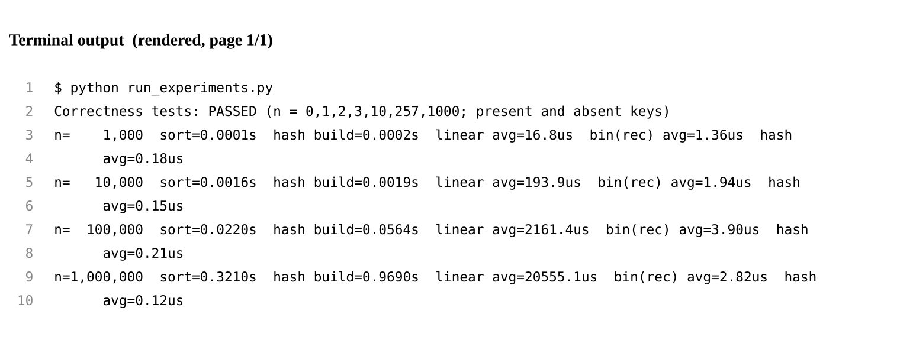
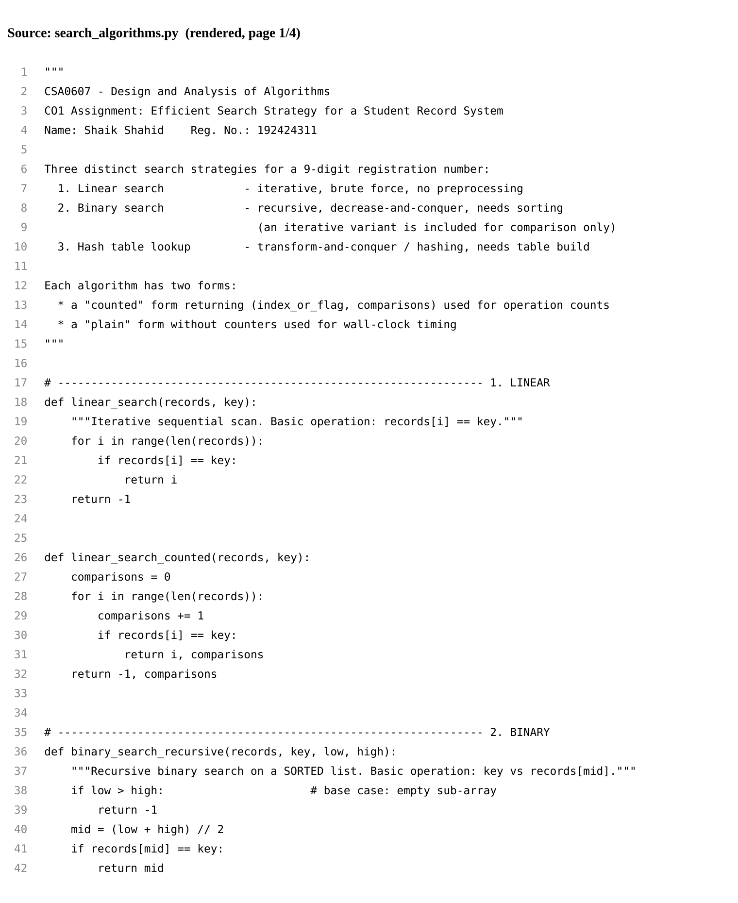
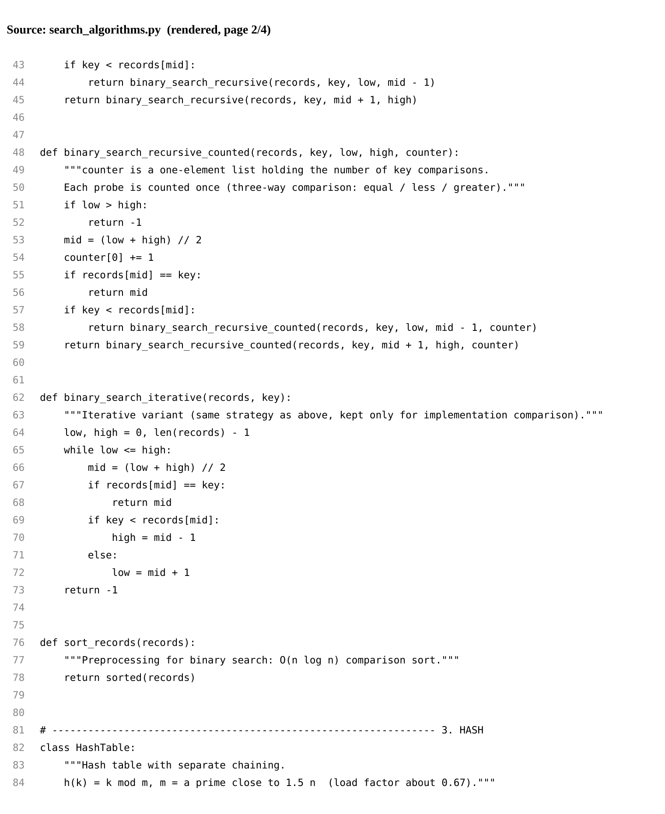
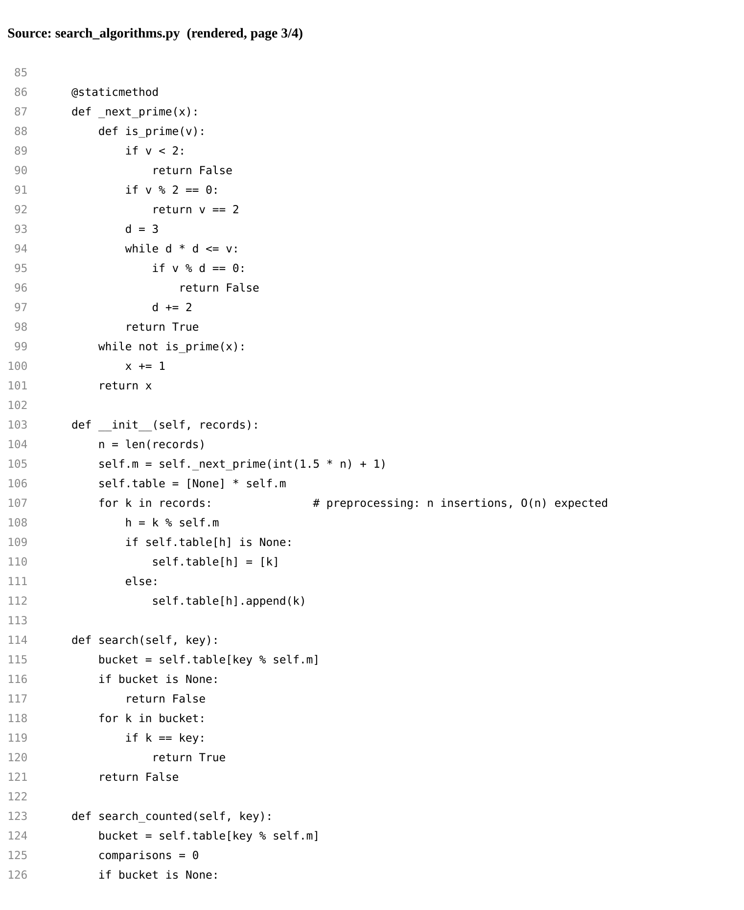
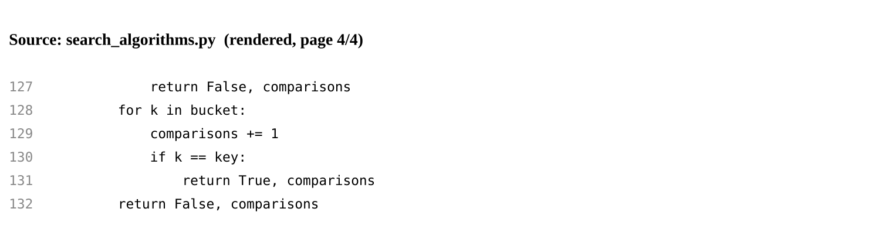
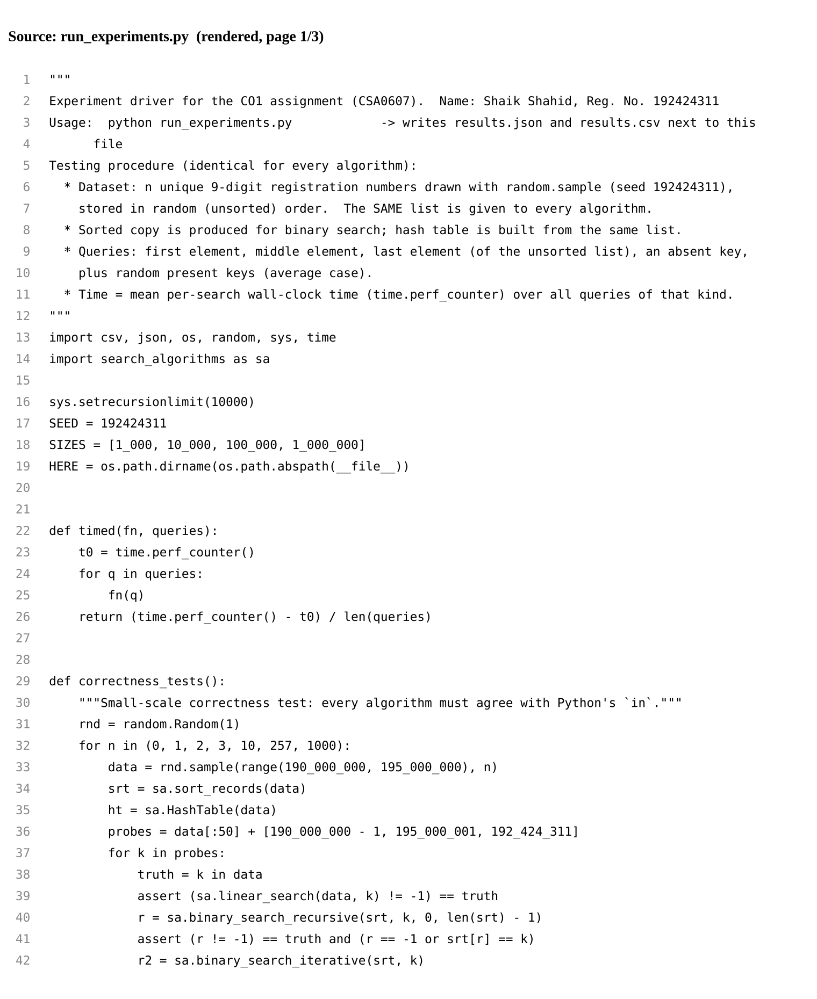
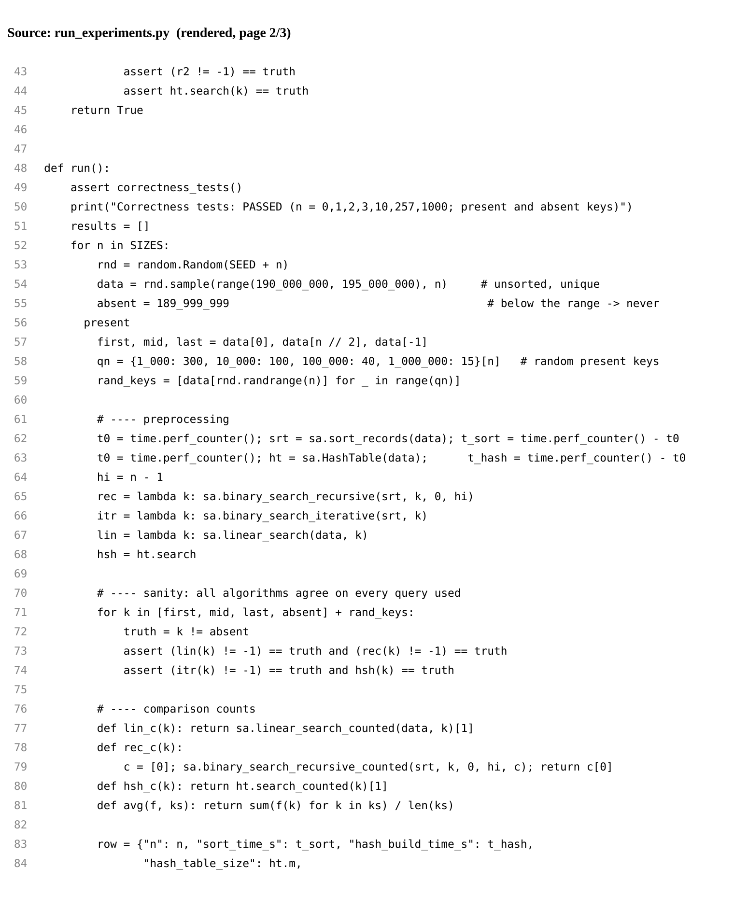
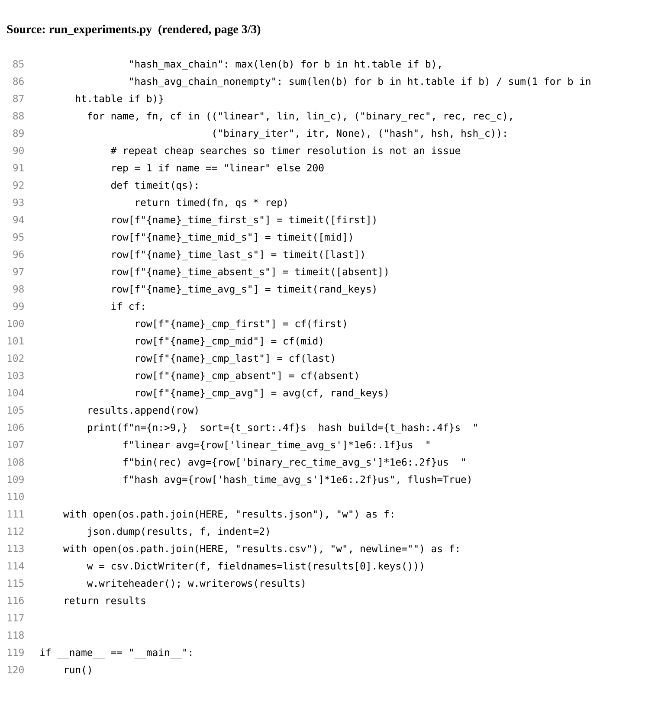

# Task 8 - Implement and Test the Algorithms (4 Marks)

Shaik Shahid | Reg. No. 192424311 | CSA0607 Design and Analysis of Algorithms

### Implementation

All algorithms are implemented in Python 3 (tested with 3.13) in Source_Code/search_algorithms.py. Each algorithm has a plain version, used for timing, and a counted version, used to record comparisons; the counted version differs only by the counter increment, so it follows the same logic as the analysed pseudocode.

**Table 8.1  Source files**

| File | Purpose |
|---|---|
| search_algorithms.py | linear_search, binary_search_recursive (+ iterative variant), HashTable class, sort_records |
| run_experiments.py | Correctness tests, dataset generation, timing and comparison counting; writes results.json and results.csv |
| make_figures.py | Graphs, flowcharts and rendered code/output images |
| results.csv / results.json | Raw measured data |

### Test procedure (reproducible)

- Dataset: for each n in {1,000; 10,000; 100,000; 1,000,000}, n unique 9-digit registration numbers are drawn from 190,000,000-194,999,999 with random.sample, using a fixed seed (192424311 + n). Records are kept in random (unsorted) order.
- The same list is given to all algorithms: linear search scans it, the sorted copy is produced from it for binary search, and the hash table is built from it.
- Queries per size: first, middle and last record of the stored list; one absent key (189,999,999); and random present keys (300, 100, 40 and 15 keys for the four sizes, fewer for large n because linear search is slow).
- Before timing, every algorithm is checked to return the correct answer (found / not found) on every query.
- Time: mean wall-clock time per search with time.perf_counter. Fast searches are repeated 200 times to overcome timer resolution; linear search is run once per query. Preprocessing (sort, hash build) is timed separately.
- Comparisons: counted by the instrumented versions. Same machine, same process and same data for all algorithms.

### Test cases

**Table 8.2  Test cases**

| No. | Test case | Expected result | Result |
|---|---|---|---|
| 1 | Empty database (n = 0), any key | Not found | Passed (all 3 algorithms) |
| 2 | One record (n = 1), key present / absent | Found / not found | Passed |
| 3 | n = 2, 3, 10, 257, 1000, first 50 stored keys | Found at a valid index | Passed |
| 4 | Key below smallest (189,999,999) and above largest (195,000,001) | Not found | Passed |
| 5 | Key 192,424,311 (may or may not be in the random data) | Same answer as Python's `in` | Passed |
| 6 | First, middle, last element of unsorted list at all four sizes | Found | Passed |
| 7 | Random present keys at all four sizes | Found | Passed |
| 8 | Absent key at all four sizes | Not found | Passed |

Each test also confirms that the index returned by binary search points to the key, and that recursive binary search, iterative binary search, linear search and the hash table agree with Python's built-in membership test.

*Figure 8.1  Terminal output of run_experiments.py (rendered image of the real console output)*

### Source code

*Figure 8.2  search_algorithms.py (rendered image, page 1)*

*Figure 8.3  search_algorithms.py (rendered image, page 2)*

*Figure 8.4  search_algorithms.py (rendered image, page 3)*

*Figure 8.5  search_algorithms.py (rendered image, page 4)*

*Figure 8.6  run_experiments.py (rendered image, page 1)*

*Figure 8.7  run_experiments.py (rendered image, page 2)*

*Figure 8.8  run_experiments.py (rendered image, page 3)*

How to reproduce: python3 run_experiments.py (about one minute), then python3 make_figures.py. Absolute times depend on the machine, so they will differ slightly on another computer; the growth pattern should not.
